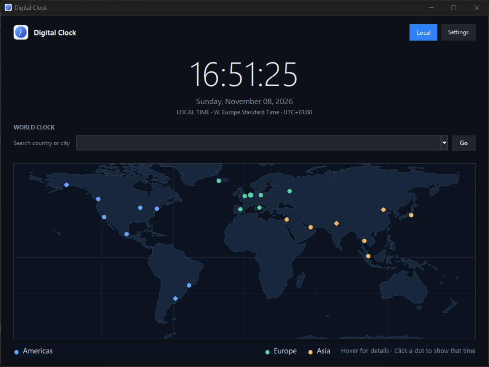

# SysClock

SysClock is a Windows world clock with a live map, searchable cities, live time
zones, and customizable time and appearance.



## Install on Windows

Choose the setup wizard, the PowerShell command, or the portable app. None of
these options requires Python or administrator access.

### Setup wizard (recommended)

1. Open [**GitHub Releases**](https://github.com/Tenqo/SysClock/releases).
2. Download `SysClock-Setup.exe` from the latest release's **Assets**.
3. Double-click the downloaded file, choose an install location, and optionally
   create a desktop shortcut.
4. Launch **SysClock** from the Start menu or your desktop shortcut.

To uninstall, open **Settings → Apps → Installed apps**, find **SysClock**, and
select **Uninstall**.

### Install from PowerShell

Open PowerShell and run:

```powershell
irm https://raw.githubusercontent.com/Tenqo/SysClock/main/scripts/install.ps1 | iex
```

This downloads the latest setup wizard from GitHub Releases and installs
SysClock for your Windows account. The command runs the install script from
this repository; review [`scripts/install.ps1`](scripts/install.ps1) before
running it if you want to inspect what it does.

### Portable version

To run the app without installing it, download `SysClock.exe` from the latest
release's **Assets** and double-click it. The portable app includes its own
Python runtime, map, and time-zone data, and works offline.

Downloads are available after the project owner publishes a GitHub Release.

## What the app does

- Shows a live world clock on a map with representative city markers.
- Lets you search for a supported country or city and jump to its time zone.
- Lets you hover over or click map markers to preview or select local times.
- Supports 12-hour and 24-hour time formats and light and dark themes.

The app bundles the runtime and time-zone data it needs, so Python is not
required to install or run the Windows downloads. City search and clock
preferences work offline. The map contains a curated selection of locations,
not every country or time zone.

Your appearance, time format, and selected location are saved locally on your
PC:

```text
%APPDATA%\DigitalClock\settings.json
```

## Windows security notice

The automated release workflow does not sign its downloads with a certificate
trusted by Windows. Windows may show a security warning or identify the
publisher as unknown. Download the app only from this project's official
[GitHub Releases](https://github.com/Tenqo/SysClock/releases) page. Do not
install an untrusted certificate or bypass a security warning just to run it.

## Run from source

This is for people who want to work with the project source. It is not required
to install or run the Windows app. Install Python 3.10 or newer, open
PowerShell in the project folder, and run:

```powershell
python -m pip install -e .
python -m sysclock
```

## Build the Windows app

Install PyInstaller:

```powershell
python -m pip install pyinstaller
```

Then run this PowerShell script from the project folder:

```powershell
$project = (Get-Location).Path
$buildRoot = Join-Path $env:TEMP "SysClockBuild"
$assets = Join-Path $project "src\sysclock\assets"
$entry = Join-Path $project "src\sysclock\__main__.py"
$versionFile = Join-Path $project "version_info.txt"
New-Item -ItemType Directory -Force (Join-Path $buildRoot "work"), (Join-Path $buildRoot "spec") | Out-Null
$buildArguments = @(
    "--noconfirm", "--clean", "--onefile", "--windowed",
    "--name", "SysClock",
    "--distpath", (Join-Path $project "dist"),
    "--workpath", (Join-Path $buildRoot "work"),
    "--specpath", (Join-Path $buildRoot "spec"),
    "--icon=$(Join-Path $assets 'digital_clock_icon.ico')",
    "--version-file", $versionFile,
    "--add-data", "$assets;sysclock/assets",
    "--collect-all", "tzdata",
    $entry
)
pyinstaller @buildArguments
```

The portable executable is created in `dist`. To build the setup wizard too,
install Inno Setup 6 and compile `installer\SysClock.iss` after building
`dist\SysClock.exe`. Publishing a GitHub Release triggers the Windows release
workflow, which builds and attaches both `SysClock-Setup.exe` and
`SysClock.exe`.

## Project and license

The original SysClock software is licensed under the
[GNU General Public License v3.0](LICENSE) (`GPL-3.0-only`). Copyright © 2026
Tenqo. You may use, modify, and redistribute the original software under the
license terms. When distributing the app, include the corresponding source
code and license.

The map uses public-domain 1:110m geographical data from
[Natural Earth](https://www.naturalearthdata.com/). Third-party dependencies
and data retain their own license terms.
